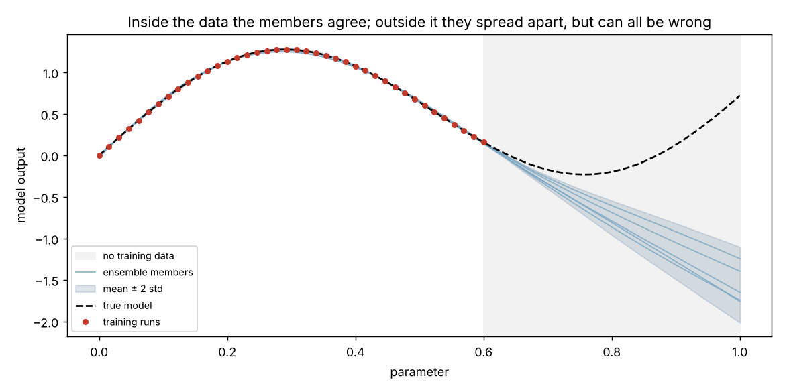

# emutrust

**Neural network emulators for slow scientific models, with calibrated uncertainty you can trust in Bayesian inference.**

> **Status:** early development (`0.1.0.dev0`). Training-set generation and the ensemble emulator are working and tested; the validation report and likelihood are in progress. See the [roadmap](#roadmap).

## The problem

Many scientific models are slow: a single evaluation of a Boltzmann code such as CAMB takes seconds, and more complex models can take minutes. Bayesian parameter inference with MCMC needs tens of thousands of evaluations, so running the model directly inside the sampler can take days.

An **emulator** is a fast stand-in: run the slow model a few hundred times, train a neural network on the results, and use the network inside the sampler instead. This can cut inference from days to seconds.

But an emulator is only approximately right. If the inference treats it as exact, its errors silently shrink the error bars and the result becomes **overconfident**. `emutrust` is built around closing that gap:

1. **Smart sampling** of training points across the parameter space, with checkpointing so slow runs are never lost.
2. **Training** of a neural network emulator that also estimates **its own uncertainty**.
3. **A validation report** showing accuracy on held-out runs, the worst cases, and where in parameter space the emulator is weak.
4. **An honest likelihood** that adds the emulator's uncertainty to the data's noise, ready for samplers such as `emcee`.

It works with **any** Python function: a cosmology code, a simulation wrapper, or any other expensive model.

## Installation

```bash
git clone https://github.com/mqurban/emutrust
cd emutrust
pip install -e ".[dev]"
```

`emutrust` needs NumPy and PyTorch. On a machine without a GPU, installing the CPU-only build of PyTorch first (`pip install torch --index-url https://download.pytorch.org/whl/cpu`) avoids a large download.

## What works today

### 1. Define the parameter space and sample training points

```python
from emutrust import ParameterSpace

space = ParameterSpace(
    {
        "H0": (60.0, 75.0),
        "omch2": (0.10, 0.14),
        "ns": (0.92, 1.00),
    }
)

X = space.sample(300, seed=42)  # Latin hypercube, shape (300, 3)
```

Points are drawn with **Latin hypercube sampling**: each parameter's range is split into 300 equal slices and every slice is used exactly once. This covers the full range of every parameter evenly, which plain random sampling does not, and avoids the exponential cost of a grid (10 values per parameter in 5 dimensions is already 100,000 runs).

### 2. Run the slow model, with checkpointing

```python
from emutrust import run_model


def my_model(params):
    # params is a dict, e.g. {"H0": 67.3, "omch2": 0.12, "ns": 0.965}
    return slow_calculation(params)  # returns an array of outputs


training = run_model(my_model, X, space, checkpoint="runs.npz")
training.X, training.Y  # inputs (300, 3) and outputs (300, n_outputs)
training.seconds_per_run  # measured cost of one model evaluation
```

Progress is saved after every run. If the session crashes after 200 runs, calling `run_model` again with the same points resumes at run 201. The checkpoint is written atomically, so an interruption during a save cannot corrupt it, and it refuses to resume if the points or parameters have changed.

`run_model` also checks every output: a run that returns NaN or infinity, or a different number of outputs from earlier runs, stops with a clear error instead of silently polluting the training set.

### 3. Train an emulator that knows its own uncertainty

```python
from emutrust import Emulator

emu = Emulator.fit(training, n_members=5, seed=0)

mean, std = emu.predict({"H0": 67.3, "omch2": 0.12, "ns": 0.965})
emu.save("emulator.pt")  # reload later with Emulator.load
```

`Emulator.fit` trains a **deep ensemble**: several neural networks on the same training set, each starting from different random weights and holding out a different random part of the data for early stopping. `predict` returns the ensemble average and the spread between members, both in the model's original units.

- **Where the training data pin the answer down, the members agree** and the spread is small.
- **Where data are thin or the function is hard to learn, they disagree**, and the spread grows. This spread is the emulator's estimate of its own error.

Inputs and outputs are standardised before training. Outputs that are all positive and span more than two orders of magnitude, such as power spectra, are learned in `log10` space automatically.

On the toy spectrum below, an ensemble of 5 networks trained on 300 runs gives, on 200 unseen test points ([`examples/toy_benchmark.py`](examples/toy_benchmark.py)):

| Metric | Result | Ideal |
|---|---:|---:|
| Mean fractional error | 0.32% | |
| Median fractional error | 0.19% | |
| Worst fractional error | 12.8% | |
| Truth within 1 std of prediction | 67% | 68% |
| Truth within 2 std of prediction | 92% | 95% |

The last two rows test whether the uncertainty is *honest*: if it is well calibrated, the true value should fall within one predicted standard deviation 68% of the time, and within two 95% of the time. The worst cases are near the edges of the parameter space, where training points are sparsest.

**A known limitation.** Outside the parameter ranges used for training, the members spread apart, which correctly signals unfamiliar ground, but they can all extrapolate in the same wrong direction, so the spread no longer measures the true error ([`examples/ensemble_uncertainty.py`](examples/ensemble_uncertainty.py)):



An emulator should therefore only be used inside the ranges it was trained on; the likelihood will enforce this.

### Toy model for testing

`emutrust.toy.toy_spectrum` is a cheap function shaped like a matter power spectrum (spanning several orders of magnitude and varying smoothly with three parameters). It is used to test every component on a problem where the right answer is known exactly, before trusting it on a real, slow model.

## Roadmap

- [x] Parameter spaces and Latin hypercube sampling
- [x] Checkpointed model runner with output validation
- [x] Neural network emulator (PyTorch) with input/output standardisation and log-space outputs
- [x] Emulator uncertainty from a deep ensemble
- [ ] Validation report: held-out accuracy, worst cases, uncertainty calibration
- [ ] Likelihood that includes emulator uncertainty, ready for `emcee`
- [ ] Demonstration on CAMB: inference with and without emulator uncertainty, compared against the true parameters
- [ ] Documentation and PyPI release

## Related work

- **[CosmoPower](https://github.com/alessiospuriomancini/cosmopower)** (Spurio Mancini et al. 2022): neural network emulators specialised for cosmological power spectra.
- **[Emukit](https://github.com/emukit/emukit)**: general emulation and uncertainty quantification based on Gaussian processes.

`emutrust` aims to be a general, lightweight tool for *any* slow model, focused on making emulator uncertainty an explicit part of the inference.

## Development

```bash
pytest          # run the tests
ruff check .    # lint
```

## License

MIT. See [LICENSE](LICENSE).
